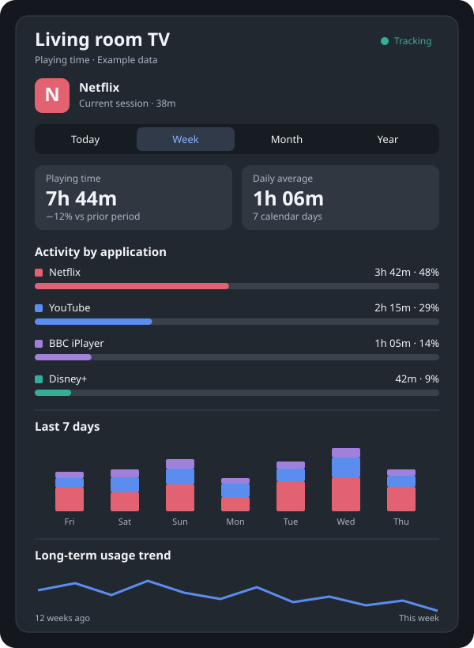

# Media Activity Tracker

Local, per-media-player playback analytics for Home Assistant 2025.12+. Includes the Media Activity Card from v0.2.0; no second download required.

**Early release:** test before relying on analytics. Statistics describe reported device activity, not verified human viewing.

## Install
[](https://my.home-assistant.io/redirect/marketplace_repository/?owner=thomtom24&repository=HA-Media-Activity-Tracker&category=integration)

For HA 2026.11 and newer, add the repository from a link in Marketplace. For older releases, use the HACS Integration custom repository flow below. The integration is not yet in the default catalogue.

Add this repository as an Integration custom repository in HACS, install, restart Home Assistant, then add Media Activity Tracker in Settings → Devices & services. Choose one player per instance. Add another instance for another player. From v0.2.1, Media Activity Tracker is classified as a service and appears in the Integrations list rather than Helpers. Restart Home Assistant after updating; do not remove or recreate existing tracker entries. No YAML required in standard storage-mode dashboards.

## Tracking
Playback (default) counts only the reported playing state, excluding common home screens. App activity counts an identified foreground app even when idle/paused; powered-on time counts active source states including menus. Labels always reflect the configured mode; these are device activity metrics, not verified human viewing. App ID is preferred, with name and source fallbacks. Unknown apps are counted in playback/power modes. Configure comma-separated exclusions using app names or id: identifiers. Additional conditions can use HA entities except Media Activity Tracker output sensors (to prevent direct feedback loops), raw state equality/inequality or strict numeric above/below, AND/OR. Unknown/unavailable inputs never satisfy a comparison; with OR another valid condition may still permit tracking. Use one comparison per entity. Options can be edited after setup. Use Reconfigure to replace the source and explicitly retain history; create a separate tracker for a clean history. Mixed source or mode history is labelled and period comparisons are suppressed. Wi-Fi trackers and source state updates can lag.

## Statistics
Independent local calendar days, Monday weeks, months, years, rolling 7/30/90/365 days, app totals, sessions, longest daily session contribution and daily averages. Pauses/buffering retain a session for the same app up to a configurable timeout (30 minutes by default); condition failure, app change, idle/off/unavailability ends it. Session counts represent sessions touching a day (a midnight-spanning session counts on both days). Longest is the longest single-day session contribution within the period. Comparisons use equivalent completed local calendar days and completed clock hours, capped equally for shorter calendar periods; no comparison is shown when prior history is incomplete or the prior baseline is zero. The current partial hour is excluded from comparison only, not from totals. Repeated DST hours are grouped by local clock hour; this is not an exact elapsed-time comparison. Averages count calendar days from installation (including the installation day and subsequent zero-activity days), never days before installation. Outages are not separately measured. Daily aggregates retained until the integration is removed, session details 90 days by default, configurable from 1–3650 days (last 500 returned; reducing retention permanently removes older detail, not aggregate totals). No historical backfill, media titles, telemetry or network access. Changed data is checkpointed roughly every 30 seconds with atomic private storage; storage failures are shown in diagnostics and retried. Clock jumps and long unobserved gaps are not inferred as activity. The history is validated on startup. Restore from backup if it is unreadable.  unobserved outages are not counted, abrupt shutdown can lose the last checkpoint interval. Removal deletes that instance's history. Back up HA storage. Changing timezone does not rebucket previously stored days.

## Card API
Authenticated WebSocket command media_activity_tracker/report with entry_id (from Tracking status sensor's tracker_entry_id attribute) and optional days (1–3660, default 366). Requires read permission on both the source and tracker status entity. Schema 1: seconds, stable app keys, periods day/week/month/year/7/30/90/365, history daily rows, sessions and current status. Card polls the local API; no external service. CSV export is client-side.

## Development
Run python -m unittest discover -s tests and python -m compileall -q custom_components. Real HA testing required before release. See LICENSE.

### Additional options
Application aliases: comma-separated key=label pairs (prefer id: identifiers, e.g. id:12=Netflix). Optional app sensors: comma-separated app labels or id: identifiers; day, week and month sensors appear for each selection. Renaming an alias after history exists may require the stable id form. Time-of-day history is aggregated by local hour; repeated DST hours are combined. CSV export covers up to 3660 days.


## Included dashboard card



After adding a tracker, refresh Home Assistant and choose **Media Activity Card** in the dashboard card picker. Select that instance's Tracking status sensor. Features: live app/session, today/week/month/year, per-app breakdown, comparisons, recent daily stacked bars, 30/90/365-day trends, weekday/time-of-day heatmaps, insights, daily target, detailed dialog, CSV export and visual editor.

```yaml
type: custom:media-activity-card
entity: sensor.example_tracking_status
period: day
trend: '90'
```

### Upgrade from the standalone v0.1.1 card

1. Back up Home Assistant. Keep the tracker integration and its config entries installed; do **not** remove them (removal deletes that instance's data).
2. Upgrade the **tracker** to v0.3.0 or later. Uninstall only the old **Media Activity Card** dashboard repository in HACS (or remove its manually installed resource). Keep your dashboard cards and YAML unchanged.
3. In Settings → Dashboards → Resources, confirm the old standalone card resource is gone; remove only that resource if it remains. Restart HA.
4. Refresh the browser or reset the Companion App frontend cache. The bundled module should be registered as `/media_activity_tracker/ha-media-activity-card.js?v=0.3.0`. Existing card configurations and tracker history use the same identifiers.
5. If the card does not appear, add the bundled URL as a JavaScript module in Resources, reload resources and refresh. Do not register both old and bundled modules.

The integration does not automatically delete the previous standalone resource, and skips bundled resource creation while a known old resource is present. For YAML-managed resources, replace the old URL with the bundled URL in your existing resources list (type: module); automatic registration is only for storage-mode resources. On future updates use the new version query parameter for YAML resources. If rolling back to v0.1.1, remove the bundled resource and reinstall the standalone card without removing tracker entries.

## Frontend development

Run `node --check custom_components/media_activity_tracker/www/ha-media-activity-card.js`, `node --test tests/*.test.cjs`, and (with Playwright installed) `node tests/browser.cjs`. The card is shipped inside the integration directory, with no build or external assets required. The original standalone project is retained for migration only.


## Troubleshooting

- **Tracking status is not tracking:** inspect the Tracking status sensor's state, source state and anonymised condition results. Each result indicates its comparison operator, availability and whether it matched. For AND every condition must match; OR needs at least one. Unknown/unavailable never matches. Download integration diagnostics for the same information without entity IDs or viewing history.
- **No previous-period comparison:** the previous period must be fully recorded from its start and have nonzero activity. The current partial local hour is excluded on both sides.
- **Card unavailable:** confirm only the bundled resource is registered, restart HA, then refresh the browser. Check HA logs for card resource registration warnings. Backend tracking continues if the optional card cannot register. Tracking status states now distinguish paused, buffering, source_off, source_unavailable and app_excluded; existing automations that test the previous generic source_not_active state may need updating.
- **Multiple trackers:** add one integration entry per media player; the shared module is registered once and each card selects its own status sensor.
- **Retention:** change detailed session retention in integration options. Daily and application aggregates are retained; pruned session details cannot be restored without a backup.

## AI-assisted development disclaimer

This project was produced using ChatGPT in response to human prompts and direction. It was not created solely by a human developer. The project owner provides requirements, reviews changes and participates in testing, while ChatGPT generates and assists with implementation, documentation and automated tests.

AI-generated code may contain errors, security issues or unexpected behaviour. The integration is provided as-is, without guarantees of reliability or suitability for any particular purpose. Please review and test it in your own environment before relying on it.

## About and support

- Website: [www.tombale.me](https://www.tombale.me)
- If you find this project useful and would like to support its development, you can [buy me a beer](https://buymeacoffee.com/tombale).

Support is entirely optional.

## Further documentation

- [Privacy and history recovery](docs/privacy.md)
- [Compatibility and testing](docs/runtime-testing.md)
- [Audit remediation status](docs/audit.md)
- [Contributing](CONTRIBUTING.md) · [Security](SECURITY.md)
